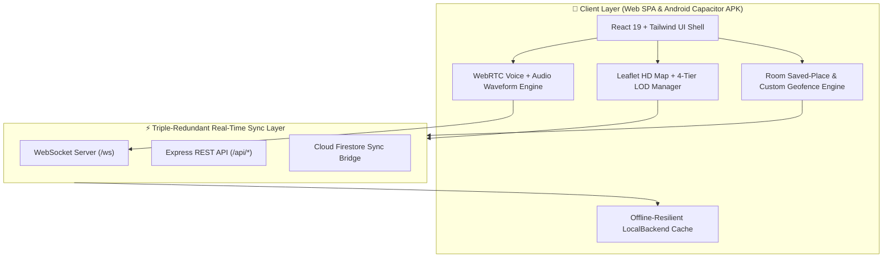

<div align="center">

# 🧭 BEACON NETWORK
### **Stay Connected · Stay Together · Real-Time Social GPS, Rooms & Safety Mesh**

[](#)
[](#)
[](#)
[](#)
[](#)
[](#)

<p align="center">
  <strong>Beacon Network</strong> is a full-stack, cross-platform real-time location sharing, group room coordination, voice/text communication, and emergency SOS response platform engineered for both <strong>Web Browsers</strong> and <strong>Android Native APKs</strong>.
</p>

[✨ Key Features](#-flagship-features) •
[🏗️ System Architecture](#️-system-architecture) •
[🗺️ Map & LOD Engine](#️-hd-map--level-of-detail-lod-engine) •
[🚀 Quick Start](#-quick-start) •
[📱 Android APK Build](#-android-apk-build--github-releases) •
[🔌 API Reference](#-rest--websocket-api-reference)

</div>

---

## 🌟 Why Beacon Network?

Unlike basic location trackers that drain battery or fail when switching between mobile networks, **Beacon Network** combines a **multi-provider HD geographical map engine**, **triple-redundant real-time synchronization** (WebSockets + Express REST + Cloud Firestore Bridge), **smart room geofencing**, and **hardware-aware power management** into a single cohesive social hub.

| Capability | Beacon Network | Traditional Trackers |
| :--- | :---: | :---: |
| **Multi-Layer HD Geographical Maps** (Street, Terrain, Satellite, Hybrid) | ✅ Instant Double-Buffered Switching | ❌ Single Static Layer |
| **Room Saved-Place Geofences** (Auto Enter/Exit Push Alerts) | ✅ Built-in Per-Room Rules (`50m`–`5km`) | ⚠️ Paid Add-on / Limited |
| **Zoom-Adaptive Level-of-Detail (LOD) GPU Culling** | ✅ 4-Tier Automatic Marker Culling | ❌ Laggy on Low-End Phones |
| **Battery-Saving Low Power Mode** (`30s` GPS / `25m` Delta Filter) | ✅ 1-Tap Toggle in Settings | ❌ Constant High Drain |
| **Discord-Style Room Channels + WebRTC Live Voice** | ✅ Multi-Channel Text, Voice Notes & RTC | ❌ Basic Text Only |
| **Live Emergency SOS with Shareable Responder Links** | ✅ Real-Time `?sos_track=` Telemetry | ⚠️ Static SMS Coordinates |
| **Cross-Device Web ↔ Android APK State Sync** | ✅ Sub-Second Hybrid Cloud Mesh | ❌ Platform Locked |

---

## ✨ Flagship Features

### 🗺️ 1. Live HD Interactive Map & Multi-Layer Tile Engine
- **Verified Multi-Provider Tile Pipeline**: Seamlessly switch between **Street**, **Physical Terrain**, **Satellite Imagery**, and **Hybrid Roads** with automatic tile-server failover and HTTP status diagnostics.
- **2D / 3D Perspective Tilt & Compass**: Interactive pitch tilt, live compass heading indicator, and smooth fly-to animations.
- **Live Telemetry & Distance Badges**: View real-time GPS accuracy (`±m`), speed, heading, battery level, and live distance lines between yourself and friends.
- **Turn-by-Turn Routing & Google Places Explorer**: Search nearby hospitals, transit, restaurants, or street addresses and launch turn-by-turn directions directly on the map.

### 🛡️ 2. Rooms & Saved-Place Geofence Automation
- **Universal Lounge & Private Rooms**: Join the global `#room-universal` community or create password-protected private group rooms with role-based permissions (`OWNER`, `ADMIN`, `MEMBER`).
- **Saved-Place Geofence Push Alerts**: Attach a geofence (`50m` to `5000m` radius) to any Saved Place inside a room:
  - 🔔 **Enter & Exit Triggers**: Automatically fires native-style push banners, device vibration, and audio chimes when a room member enters or leaves the zone.
  - 💬 **Auto Room Chat Broadcast**: Optionally posts real-time arrival/departure logs to the room's chat channel.
- **Custom Drawn Polygon & Circle Geofences**: Draw freeform safety perimeters directly on the map canvas.

### 💬 3. Real-Time Multi-Channel Chat & WebRTC Voice
- **Structured Room Channels**: Dedicated `#general`, `#live-locations`, `#announcements`, and `#lounge` channels per room, plus private **1-on-1 Direct Messaging**.
- **Rich Telemetry Cards**: Broadcast one-tap **Live Beacon Coordinate Cards** with embedded `"Locate on Map"` actions.
- **Voice Messages & Reactions**: Record voice notes with live **Audio Waveform Visualizers**, reply to threads, react with emojis, and clear unread badges in a single tap.
- **Live WebRTC Voice Channels**: Hop into `General Voice` or `Field Ops Radio` for low-latency peer-to-peer spatial voice chat.

### 🚨 4. Emergency SOS Broadcast & Responder Tracking
- **1-Tap SOS Siren & Broadcast**: Broadcasts high-priority emergency alerts with your live GPS coordinates, accuracy radius, and custom distress message to your active room or the entire network.
- **Nearby Responder Radar**: Automatically highlights members within a **5 km radius** sorted by distance.
- **Shareable Live Tracking Links**: Generates expiring `?sos_track=` URLs so external responders or family members can track live movement in real time.

### 🔋 5. Low Power Mode & Level-of-Detail (LOD) Performance Engine
- **Low Power Mode**: Reduces GPS hardware polling to `30-second` intervals with a `25-meter` minimum movement filter and throttles background map refreshes from `15s` to `45s` for maximum battery longevity.
- **Automatic 4-Tier Map LOD Manager**: Dynamically hides non-essential markers (secondary saved places, community pins, and accuracy rings) when zoomed out while always preserving Emergency SOS pins and the current user's location marker.

---

## 🏗️ System Architecture



---

## 🗺️ HD Map & Level-of-Detail (LOD) Engine

The `mapLodManager` (`src/utils/mapLodManager.ts`) continuously evaluates the current Leaflet zoom level (`1`–`20`) and device power state to keep frame rates at a locked **60 FPS**:

| LOD Tier | Standard Zoom | Low Power / Lite Zoom | Visible Map Elements |
| :--- | :---: | :---: | :--- |
| **`minimal`** *(World / Country)* | `Zoom < 9` | `Zoom < 10` | Current User Marker, Active Emergency SOS Pins |
| **`low`** *(Regional / Metro)* | `Zoom 9 – 11` | `Zoom 10 – 12` | + Connected Friends' Live GPS Markers |
| **`medium`** *(City / District)* | `Zoom 12 – 13` | `Zoom 13 – 14` | + Saved Places, Custom Geofence Perimeters, Accuracy Circles |
| **`high`** *(Street / Neighborhood)* | `Zoom ≥ 14` | `Zoom ≥ 15` | + Rich Member Distance Badges, Crowd Heatmaps, Community Pins, Nearby Search POIs |

---

## 🚀 Quick Start

### Prerequisites
- **Node.js** `v20+` or `v22+`
- **npm** `v10+`
- *(Optional for Android APK)* **Java JDK 17+** & **Android SDK**

### 1. Clone & Install Dependencies

```bash
git clone <your-repo-url>
cd beacon-network
npm install
```

### 2. Configure Environment *(Optional)*

Copy `.env.example` to `.env` if you wish to customize optional provider keys (the app works out-of-the-box with zero API keys required for street, terrain, and satellite maps):

```bash
cp .env.example .env
```

### 3. Run Development Server

```bash
npm run dev
```

Open **`http://localhost:3000`** in your browser. Both the Vite React frontend and the Express + WebSocket (`/ws`) server run together on port `3000`.

### 4. Production Build & Start

```bash
npm run build
npm start
```

---

## 📱 Android APK Build & GitHub Releases

Beacon Network includes a pre-configured **Capacitor 8 Android project** (`com.beacon.mesh`) and an automated **GitHub Actions APK Release pipeline** (`.github/workflows/build-apk.yml`).

### Build APK Locally via CLI

```bash
# 1. Build web assets, sync Capacitor Android, and prepare Gradle configs
npm run cap:sync

# 2. Compile Debug APK
npm run build:apk

# 3. Compile both Debug & Signed Release APKs
npm run release:apk
```

**Generated APK Output Paths:**
- **Debug APK**: `android/app/build/outputs/apk/debug/app-debug.apk`
- **Signed Release APK**: `android/app/build/outputs/apk/release/app-release.apk`

### Automatic GitHub Releases (GitHub Actions)
Pushing to `main` or pushing a version tag (`v*`) automatically triggers `.github/workflows/build-apk.yml`, which compiles and publishes `Beacon-Network.apk`, `app-release.apk`, `app-debug.apk`, and `SHA256SUMS.txt` directly to your repository's **GitHub Releases** page.

---

## 🔌 REST & WebSocket API Reference

<details>
<summary><strong>Click to expand REST API Endpoints (<code>server.ts</code>)</strong></summary>

| Method | Endpoint | Description |
| :--- | :--- | :--- |
| `GET` | `/api/health` | Production backend health & auth status check |
| `GET / POST` | `/api/sync/state` | Cross-device state synchronization snapshot |
| `POST` | `/api/auth/register` | Register a new Beacon Network account |
| `POST` | `/api/auth/login` | Authenticate by `@username` or email |
| `POST` | `/api/auth/session-restore` | Silent token & session restoration across Web/APK |
| `GET` | `/api/rooms` | List all rooms for the authenticated user |
| `POST` | `/api/rooms` | Create a new public or password-protected room |
| `POST` | `/api/rooms/join` | Join a room by Room ID and optional password |
| `GET` | `/api/messages` | Fetch recent room and direct messages for badge & feed sync |
| `GET / POST / DELETE` | `/api/rooms/:id/messages` | Get, send, or clear messages in a specific room |
| `GET / DELETE` | `/api/direct-messages/:userId` | Get or clear 1-on-1 direct message history |
| `POST` | `/api/locations/update` | Publish live GPS coordinates, heading, speed & battery |
| `GET` | `/api/locations/live` | Retrieve permitted live GPS locations of friends & room peers |
| `POST` | `/api/locations/request` | Send a friend & location-sharing request |
| `POST` | `/api/locations/respond` | Accept, grant temporary (1h), or decline a request |
| `GET / POST / PUT / DELETE` | `/api/saved-places` | Manage personal and room-shared Saved Places |
| `GET / POST` | `/api/alerts/emergency` | Broadcast or list active Emergency SOS alerts |
| `POST` | `/api/alerts/emergency/:id/share` | Generate a temporary responder tracking token |

</details>

<details>
<summary><strong>Click to expand Real-Time WebSocket Events (<code>/ws</code>)</strong></summary>

- `location:update` / `location:broadcast` — Sub-second GPS coordinate, heading, and accuracy streaming.
- `chat:message` / `chat:message_updated` / `chat:cleared` — Instant room channel and direct message delivery.
- `chat:typing` — Throttled real-time typing indicators.
- `emergency:broadcast` / `emergency:ack_update` / `emergency:resolved` — Live SOS siren, responder acknowledgment, and resolution sync.
- `voice:join` / `voice:leave` / `voice:signal` / `voice:speaking` — WebRTC signaling for live audio channels.

</details>

---

## 📂 Project Structure

```text
beacon-network/
├── .github/workflows/build-apk.yml   # Automated Android APK CI/CD release pipeline
├── android/                          # Native Capacitor 8 Android project (com.beacon.mesh)
├── scripts/prepare-android-apk.mjs   # Gradle & JDK 17 normalization script
├── server.ts                         # Full-stack Express REST + WebSocket (/ws) server
├── src/
│   ├── App.tsx                       # Main application shell, navigation & badge sync
│   ├── types.ts                      # Shared TypeScript interfaces & contracts
│   ├── config/
│   │   └── env.ts                    # Runtime URLs, Firestore config & HTTP error monitor
│   ├── context/
│   │   ├── AuthContext.tsx           # Session lifecycle & silent re-authentication
│   │   ├── RealtimeContext.tsx       # GPS watcher, WebSocket client & WebRTC voice
│   │   ├── ThemeContext.tsx          # 6 UI themes, Lite Mode & Low Power Mode state
│   │   └── ToastContext.tsx          # Non-blocking toast notifications
│   ├── components/
│   │   ├── Alerts/                   # Emergency SOS Center & live responder map
│   │   ├── Chat/                     # Multi-channel chat, voice recorder & waveforms
│   │   ├── Friends/                  # Friend connections & location permission controls
│   │   ├── Home/                     # Interactive Home Hub dashboard
│   │   ├── Map/                      # LiveMap, CustomGeofences & CrowdZone overlays
│   │   ├── Meetings/                 # Group meetup scheduler & RSVPs
│   │   ├── Navigation/               # Top Navbar, Mobile BottomNav & Desktop NavRail
│   │   ├── Notifications/            # Unified Activity & Notification Center
│   │   ├── Places/                   # Google Places & OpenStreetMap POI Explorer
│   │   ├── Profile/                  # Privacy, Low Power Mode & Theme customization
│   │   ├── Reminders/                # Location-based & time-based reminders
│   │   ├── Rooms/                    # Rooms Manager & Saved-Place Geofence rules
│   │   └── SavedPlaces/              # Saved Places bookmark manager
│   └── utils/
│       ├── api.ts                    # Resilient API client with automatic failover
│       ├── cloudSync.ts              # Multi-device Cloud Firestore & relay sync engine
│       ├── geo.ts                    # Haversine distance, bearing & formatting utilities
│       ├── localBackend.ts           # Offline-capable local database mirror
│       ├── mapLodManager.ts          # 4-tier zoom-adaptive Level-of-Detail manager
│       └── roomGeofences.ts          # Saved-place geofence enter/exit evaluator
└── vite.config.ts                    # Vite bundler & PWA configuration
```

---

## 🔒 Privacy & Security by Design

- **Granular Visibility Controls**: Choose who can see your live location (`public`, `room_members`, `friends_only`, or `nobody`) or set a **1-Hour Temporary Sharing Timer** that automatically revokes access upon expiration.
- **Zero-Secret Client Bundle**: Sensitive credentials are never logged or exposed in diagnostic payloads (`getMaskedBackendUrl` & `syncLogger` automatically redact tokens, keys, and passwords).
- **Instant User Blocking**: Block any user in one tap to immediately sever direct messaging and hide live GPS telemetry.

---

<div align="center">
  <sub>Built with ❤️ for seamless real-time coordination across Web & Android.</sub>
</div>
